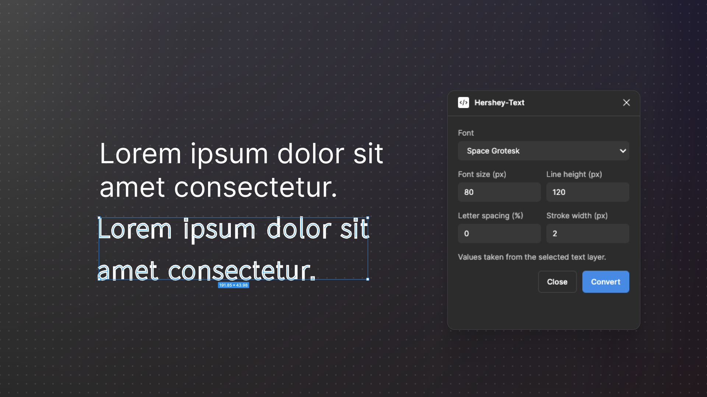

# Figma Hershey Text
This Figma Plugin lets you convert text into path fonts for CNC or Plotter use.
You can adjust the font size, line height and the letter spacing. 
More fonts and options are planned.





## Fonts
All fonts are listed in `tools/fonts.json`, in the order they appear in the plugin's dropdown.

- **Single-stroke SVG fonts** (Hershey, EMS) live in `/fonts` and only need an entry with `label` and `svg`.
- **Outline fonts** (TTF/OTF, e.g. from Google Fonts) are converted to single-stroke fonts automatically. Add a `convert` block with a `url` (or a local `file`, relative to `tools/`) and optionally `axes` to pin a variable font, e.g. `{ "wght": 300 }`. Lighter weights give cleaner centrelines.

```json
{
  "label": "Space Grotesk",
  "svg": "SpaceGrotesk.svg",
  "convert": {
    "url": "https://github.com/google/fonts/raw/main/ofl/spacegrotesk/SpaceGrotesk%5Bwght%5D.ttf",
    "axes": { "wght": 300 },
    "source": "Space Grotesk Light",
    "designer": "Florian Karsten",
    "link": "https://fonts.google.com/specimen/Space+Grotesk"
  }
}
```

## Fonts workflow
```sh
pip install fonttools numpy scipy scikit-image pillow
npm run fonts                                       # convert new outline fonts, regenerate font data
python3 tools/build_fonts.py --only "Space Grotesk" # re-convert one font
python3 tools/build_fonts.py --force                # re-convert all outline fonts
npm run build
```
`build_fonts.py` writes the font data into `code.ts` (between the `fonts:start` / `fonts:end` markers), so nothing needs to be copied by hand. The plugin UI reads the font list from the plugin at startup.

The outline conversion (`tools/outline_to_stroke.py`) rasterises each glyph, thins it to its centreline and traces it back into polylines. Results are good for most glyphs; places where strokes cross (e.g. `$`, `€`) can look a little rough, and may be touched up by editing the generated SVG in `/fonts` (then run `build_fonts.py` without `--force`).

## Development
Requires Node.js.

```sh
npm install
npm run watch   # or: npm run build
npm run lint    # ESLint 9 with Figma's plugin rules (@figma/eslint-plugin-figma-plugins)
```
In Figma desktop: *Plugins → Development → Import plugin from manifest…* and pick `manifest.json`.

---

Sources
- Fonts: https://github.com/msurguy/cnc-text-tool/tree/master/src
- Space Grotesk: https://github.com/floriankarsten/space-grotesk (SIL Open Font License)